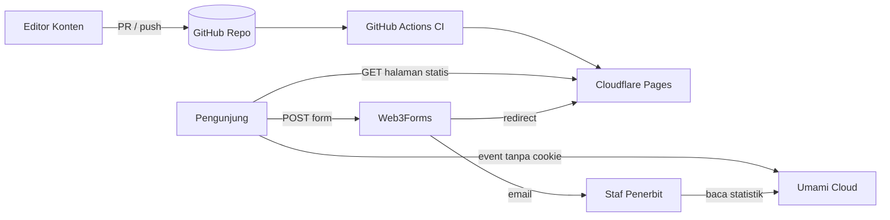

<!-- planything project:cc37d689-5d00-432e-81ce-036e542877c8 | managed file: keep task ids, only edit the [ ] markers and Note lines -->

# Landing Page Biadenrekacipta: Penerbit Buku & Jurnal Akademik

## 1. Ringkasan

Satu halaman marketing statis untuk Biadenrekacipta, penerbit buku dan jurnal akademik. Pengunjung (mahasiswa, dosen, peneliti, pembaca buku, penulis) harus paham profil penerbit dengan cepat, lalu lihat legalitas, katalog unggulan, alur dan syarat terbit, dan mengajukan naskah lewat form.

Pembeda utama: **proses terbit jelas dan transparan**. Tiap tahap alur wajib punya durasi dan biaya (atau pernyataan tertulis kapan biaya dikonfirmasi).

Keputusan teknis:
- Situs statis (Astro), tanpa backend, tanpa DB, tanpa login, tanpa upload, tanpa payment, tanpa AI.
- Konten di file JSON di repo, diedit lewat pull request.
- Form lewat layanan pihak ketiga.
- Analytics tanpa cookie.
- SEO dan GEO wajib.

Desain visual: mengikuti prompt referensi desain milik user. Prompt itu masuk repo di `docs/design-reference.md`. Agent tidak boleh mengarang warna, font, atau gaya sendiri (lihat [GR-12]).

## 2. Business Case & Go/No-Go

Semua angka adalah estimasi. Tidak ada yang diberikan di brief, jadi semua `[verify]`.

| Item biaya | Estimasi | Dasar |
|---|---|---|
| Build Fase 1 (landing end to end + deploy) | 2,5 person-hari = Rp 1.250.000 | 1 person-hari = Rp 500.000 [verify] |
| Build Fase 2 (katalog, testimoni, FAQ, SEO/GEO penuh, analytics) | 2 person-hari = Rp 1.000.000 | tarif sama [verify] |
| Fase 3 (review pasca rilis) | 0,5 person-hari = Rp 250.000 | tarif sama [verify] |
| Kumpulkan konten oleh staf penerbit (legalitas, katalog, testimoni, jawaban FAQ) | 2 person-hari = Rp 600.000 | Rp 300.000/hari [verify] |
| **Total sekali bayar** | **Rp 3.100.000** | jumlah di atas |
| Domain | Rp 250.000/tahun | harga umum [verify] |
| Hosting Cloudflare Pages | Rp 0 | free tier [verify] |
| Form Web3Forms | Rp 0 | free tier [verify] |
| Analytics Umami Cloud | Rp 0 | free tier [verify] |
| **Biaya 12 bulan** | **Rp 3.350.000** | Rp 3.100.000 + Rp 250.000 |

**Manfaat per bulan (estimasi):**
- Hemat waktu staf: halaman menjawab pertanyaan berulang soal alur, syarat, dan legalitas. Asumsi 10 pertanyaan/minggu × 10 menit ≈ 7 jam/bulan × Rp 50.000/jam = **Rp 350.000/bulan** [verify].
- Non-moneter: jumlah pengajuan naskah via form per bulan. Metrik pembuktian ada di bagian 5.

**Hitungan:**
- Manfaat 12 bulan = Rp 4.200.000.
- ROI = (4.200.000 − 3.350.000) / 3.350.000 ≈ **25%**.
- Payback = 3.100.000 / (350.000 − 21.000 biaya domain per bulan) ≈ **9,4 bulan**.

ROI tipis dan sepenuhnya bergantung pada asumsi jam hemat. Nilai sebenarnya ada di pengajuan naskah, yang belum bisa dihitung rupiahnya tanpa data [verify].

**Kill criteria:**
- [KILL-1] Penerbit tidak bisa menyediakan data legalitas terverifikasi (minimal 1 item yang bisa dibuktikan) dan alur terbit dengan durasi + biaya per tahap. Landing dihentikan atau dirombak jadi halaman kontak sederhana (checked at akhir Fase 1).
- [KILL-2] Kurang dari 5 pengajuan valid lewat form dalam 90 hari setelah rilis Fase 2, dihitung dari kunjungan unik ke `/terima-kasih/` dikurangi tes internal. Fokus pindah ke akuisisi traffic, bukan ke halaman (checked at 90 hari setelah rilis Fase 2).
- [KILL-3] Spam lebih dari 50% dari submission form selama 2 bulan berturut-turut. Tambah Turnstile atau ganti layanan form (checked at Fase 3).
- [KILL-4] Lighthouse mobile Performance di bawah 90 setelah Fase 2. Rescope gambar dan font sebelum rilis (checked at akhir Fase 2).

**Go/No-Go:** GO WITH CONDITIONS: (1) penerbit menyerahkan legalitas terverifikasi dan alur terbit dengan durasi + biaya per tahap sebelum Fase 1 selesai; (2) asumsi 10 pertanyaan/minggu dan tarif dikonfirmasi penerbit; (3) `docs/design-reference.md` ada di repo sebelum UI dikerjakan.

## 3. Masalah & Peluang

**Masalah:**
- Pengunjung susah menilai kredibilitas penerbit akademik. Legalitas (ISBN, dll.), alur terbit, dan katalog tersebar atau tidak ada di satu tempat.
- Penulis tidak tahu tahapan, syarat, durasi, dan biaya sebelum menghubungi penerbit. Penerbit menjawab pertanyaan sama berulang kali.
- Cara pengunjung mencari penerbit sekarang [verify]: kemungkinan pencarian Google, rekomendasi kolega, dan media sosial.

**Peluang:**
- Satu halaman yang menjawab "siapa kalian, sah atau tidak, apa yang sudah terbit, bagaimana prosesnya" dalam satu kali scroll.
- Transparansi proses jadi pembeda dibanding penerbit lain.
- Halaman terstruktur (JSON-LD, `llms.txt`, FAQ) mudah dikutip mesin pencari dan AI answer engine saat orang bertanya "penerbit jurnal akademik yang bisa dipercaya".

## 4. Target Pengguna & Persona

Persona di bawah adalah arketipe kerja dari jawaban user, bukan hasil riset [verify].

| Persona | Konteks | Cara sekarang [verify] | Butuh dari halaman |
|---|---|---|---|
| **Penulis akademik** (dosen, peneliti, mahasiswa pascasarjana). **Primer.** | Punya naskah buku atau artikel, mencari penerbit | Google, tanya kolega, cek media sosial penerbit | Legalitas, alur, syarat, biaya, form pengajuan |
| **Penulis umum** | Punya naskah non-akademik atau populer | Sama | Alur dan syarat, kontak cepat |
| **Mahasiswa** | Cari referensi atau tempat menerbitkan skripsi/artikel | Google Scholar, kampus | Katalog jurnal, syarat artikel |
| **Pembaca buku** | Cari judul tertentu | Toko online, media sosial | Katalog unggulan, link beli atau baca |
| **Staf penerbit** | Menerima pengajuan, mengedit konten | Email, WhatsApp | Notifikasi form yang rapi, konten mudah diedit |

## 5. Tujuan & Metrik Sukses

Semua target adalah target kerja. Baseline belum ada [verify].

| Metrik | Definisi | Target |
|---|---|---|
| Paham profil cepat | Tes 5 detik dengan 5 orang dari target pengguna: berapa yang bisa menyebut penerbit ini menerbitkan apa dan cara mengajukan | ≥ 4 dari 5 |
| Konversi pengajuan | Kunjungan unik `/terima-kasih/` ÷ pengunjung unik `/`, 30 hari, tanpa traffic tim | ≥ 2% [verify] |
| CTR CTA utama | Pengunjung unik yang klik event `cta-ajukan` ÷ pengunjung unik `/` | ≥ 5% [verify] |
| Performa | Lighthouse mobile: Performance, SEO, Accessibility | ≥ 90, ≥ 95, ≥ 95 |
| Core Web Vitals mobile | LCP, CLS, INP | < 2,5 s, < 0,1, < 200 ms |
| Kelengkapan transparansi | Tahap alur dengan durasi dan biaya terisi ÷ total tahap | 100% |

## 6. Di Luar Cakupan

Jangan dibangun:
- Backend, API sendiri, DB, CMS, admin panel.
- Login, akun, dashboard penulis, tracking status naskah.
- Upload file (naskah dikirim lewat link, bukan upload).
- Toko online, keranjang, payment, checkout.
- Halaman detail per buku atau jurnal (katalog hanya kartu dengan link eksternal).
- Blog, berita, newsletter, komentar.
- Reader PDF atau pengelolaan jurnal (OJS) di situs ini.
- Versi bahasa Inggris.
- Fitur AI, chatbot.
- Cookie banner (analytics tanpa cookie).
- Fitur "balik lagi" seperti notifikasi atau berlangganan (jawaban user dilewati; lihat bagian 23).

## 7. User Stories

- As a penulis akademik, I want melihat alur terbit lengkap dengan durasi dan biaya per tahap, so that saya bisa memutuskan tanpa harus bertanya dulu.
- As a penulis akademik, I want melihat legalitas penerbit (ISBN, dll.), so that saya yakin penerbit ini sah.
- As a penulis, I want mengirim pengajuan naskah lewat form dengan link naskah, so that tim penerbit bisa menilai tanpa saya upload file.
- As a dosen, I want melihat daftar jurnal unggulan dan syaratnya, so that saya tahu jurnal mana yang cocok.
- As a pembaca buku, I want melihat buku unggulan beserta link ke tempat beli atau baca, so that saya bisa langsung ke sumbernya.
- As a mahasiswa, I want melihat testimoni dan logo institusi yang sudah bekerja sama, so that saya percaya penerbit ini dipakai orang seperti saya.
- As a peneliti, I want halaman yang cepat dibuka di HP, so that saya bisa cek penerbit dari mana saja.
- As a staf penerbit, I want mengedit konten lewat file JSON di repo, so that perubahan tercatat dan bisa di-rollback.
- As a staf penerbit, I want menerima pengajuan di email dengan semua field jelas, so that saya tidak perlu menanyakan ulang.

## 8. Fitur & Kebutuhan Fungsional

### Hero & CTA
**Fase:** 1 · **Prioritas:** Must

Bagian paling atas. Jawab "ini siapa dan apa yang bisa saya lakukan" dalam satu layar.

- [FR-1] The system shall render satu `h1` dan satu kalimat nilai dari `site.json` (`tagline`, `ringkasan`), dengan dua CTA: "Ajukan Naskah" menuju `#ajukan` dan "Lihat Katalog" menuju `#katalog`. Jika katalog kosong, CTA kedua menjadi "Lihat Alur Terbit" menuju `#alur`.
- [FR-2] The system shall render nav header berisi anchor hanya ke section yang tampil, dan harus jalan tanpa JavaScript (menu mobile pakai `
`).
- [FR-3] The system shall menampilkan maksimal 3 badge legalitas ringkas di bawah CTA, dari item legalitas dengan `tampilDiHero: true`.
- [FR-4] The system shall menjaga CTA utama terlihat tanpa scroll di viewport 360×640.

### Profil Penerbit & Legalitas
**Fase:** 1 · **Prioritas:** Must

- [FR-5] The system shall membuka section profil dengan jawaban faktual 2 kalimat (siapa, menerbitkan apa, lokasi) dari `site.json`.
- [FR-6] The system shall menampilkan daftar legalitas dari `legalitas.json`: label, nilai, dan link bukti opsional, hanya untuk item `terverifikasi: true` ([BR-1]).
- [FR-7] The system shall menampilkan kontak resmi (email, WhatsApp, alamat) dari satu sumber `site.json`, dipakai ulang di footer, JSON-LD, dan `llms.txt`.
- [FR-8] The system shall menampilkan angka klaim (jumlah terbitan, tahun berdiri, dll.) hanya jika field `sumber` terisi ([BR-3]).

### Alur & Syarat Penerbitan
**Fase:** 1 · **Prioritas:** Must

Inti pembeda: transparansi.

- [FR-9] The system shall merender tahap dari `alur.json` berurutan: nomor, judul, deskripsi, penanggung jawab, durasi, biaya, output.
- [FR-10] The system shall merender syarat naskah per jenis (buku, jurnal) dari `syarat.json` sebagai dua grup, tanpa JavaScript.
- [FR-11] The system shall menutup section dengan CTA menuju `#ajukan`.
- [FR-12] The system shall menampilkan janji waktu balasan ("dibalas dalam N hari kerja") hanya jika `slaBalasanHariKerja` terisi ([BR-12]).

### Form Pengajuan Naskah & Kontak
**Fase:** 1 · **Prioritas:** Must

- [FR-13] The system shall menyediakan form dengan field sesuai [BR-7], label terlihat, dan validasi HTML5 native.
- [FR-14] The system shall mengirim form lewat HTTP POST ke Web3Forms dengan hidden field `access_key`, `subject`, `from_name`, `redirect`, dan honeypot `botcheck`.
- [FR-15] The system shall mengarahkan submit sukses ke `/terima-kasih/`, yang menjelaskan langkah berikutnya (dari tahap 2 alur dan SLA bila ada).
- [FR-16] The system shall menandai `/terima-kasih/` dengan `noindex` dan mengeluarkannya dari `sitemap.xml`.
- [FR-17] The system shall mewajibkan checkbox persetujuan yang menaut ke `/kebijakan-privasi/`.
- [FR-18] The system shall menampilkan link email dan WhatsApp langsung di samping form sebagai jalur cadangan.

### Katalog Buku & Jurnal Unggulan
**Fase:** 2 · **Prioritas:** Must

- [FR-19] The system shall merender grid buku dari `buku.json` untuk item `unggulan: true` dan `status` ≠ `diarsipkan` ([BR-4], [BR-5], [BR-10]).
- [FR-20] The system shall merender daftar jurnal dari `jurnal.json` dengan aturan sama.
- [FR-21] The system shall menampilkan per item: sampul (WebP, width dan height diset), judul, penulis atau editor, tahun, ISBN/ISSN, ringkasan ≤ 200 karakter, dan link eksternal dengan `rel="noopener noreferrer"`.
- [FR-22] The system shall menampilkan lencana "Segera terbit" untuk `status: segera-terbit`.
- [FR-23] The system shall menghasilkan JSON-LD `Book` per buku dan `Periodical` per jurnal dari data yang sama.

### Testimoni & Logo Penulis/Institusi
**Fase:** 2 · **Prioritas:** Should

- [FR-24] The system shall merender testimoni dari `testimoni.json` hanya untuk item `izin: true` dengan `tanggalIzin` terisi ([BR-2]).
- [FR-25] The system shall merender strip logo dari `mitra.json` dengan `alt` wajib dan link opsional.
- [FR-26] The system shall menyembunyikan section (dan link nav-nya) bila tidak ada item yang lolos ([BR-6]).

### FAQ
**Fase:** 2 · **Prioritas:** Should

- [FR-27] The system shall merender FAQ dari `faq.json` memakai `
/
` tanpa JavaScript.
- [FR-28] The system shall menampilkan peringatan build bila FAQ kurang dari 5 item. Isi awal mencakup alur, syarat, durasi, biaya, ISBN, dan proses review jurnal.
- [FR-29] The system shall menghasilkan JSON-LD `FAQPage` dari data yang sama dengan FAQ yang tampil ([BUG-6]).

### SEO, GEO & Analytics
**Fase:** 2 · **Prioritas:** Must

Fondasi `<head>`, sitemap, robots, dan 404 dikerjakan di Fase 1. Sisanya selesai di Fase 2.

- [FR-30] The system shall memakai satu komponen `<head>` bersama: `title`, `description`, canonical, Open Graph, Twitter card. Build gagal jika `title` > 60 atau `description` > 155 karakter.
- [FR-31] The system shall menghasilkan `sitemap.xml`, `robots.txt`, `llms.txt` (dari data konten), dan halaman 404.
- [FR-32] The system shall menyisipkan JSON-LD `Organization` + `WebSite` di `/` dan `BreadcrumbList` di `/kebijakan-privasi/`.
- [FR-33] The system shall memuat Umami dengan `defer`, tanpa cookie, dan mencatat event lewat atribut `data-umami-event` pada CTA.
- [FR-34] The system shall menyajikan file `_headers` berisi CSP, `X-Content-Type-Options`, `Referrer-Policy`, `frame-ancestors 'none'`, dan `X-Robots-Tag: noindex` untuk domain `*.pages.dev`.
- [FR-35] The system shall memproses gambar ke WebP/AVIF sesuai ukuran tampil, dengan width, height, dan `loading="lazy"` untuk gambar di bawah fold.

## 9. Aturan Bisnis & Edge Case

- [BR-1] Item legalitas tampil hanya jika `terverifikasi: true` dan `nilai` tidak kosong. Selain itu tidak dirender. Lihat [KILL-1].
- [BR-2] Testimoni tampil hanya jika `izin: true` dan `tanggalIzin` terisi. Kutipan verbatim, maksimal 300 karakter. Tidak boleh diedit isinya oleh agent.
- [BR-3] Angka klaim (jumlah buku, penulis, tahun berdiri, dll.) tampil hanya jika field `sumber` terisi. Build gagal jika angka ada tanpa sumber. Agent dilarang mengarang angka.
- [BR-4] Maksimal 12 buku dan 6 jurnal unggulan. Build gagal jika lebih (default, confirm).
- [BR-5] Urutan katalog: `urutan` naik, lalu `tahun` turun.
- [BR-6] Section dengan 0 item lolos filter disembunyikan, link nav dan CTA terkait ikut disesuaikan. Build memberi peringatan, bukan error.
- [BR-7] Field form wajib: `nama` (2–100), `email` (format email), `peran` (select: Mahasiswa, Dosen, Peneliti, Penulis umum, Lainnya), `jenis` (select: Ajukan naskah buku, Ajukan artikel jurnal, Pertanyaan umum), `judul_atau_topik` (3–200), `pesan` (20–1000), `persetujuan` (checkbox). Opsional: `institusi` (≤ 150), `link_naskah`. Validasi kondisional tidak dipakai karena situs tanpa JavaScript.
- [BR-8] `link_naskah`: hanya `https://`, maksimal 500 karakter, host tidak dibatasi (default, confirm). Link tidak pernah di-fetch atau ditampilkan di situs. Staf membuka dari email mengikuti checklist di README.
- [BR-9] Konten `legalitas.json` dan `testimoni.json` wajib di-approve satu reviewer selain penulis PR (default, confirm). Editor tidak boleh merge perubahan klaim legal miliknya sendiri.
- [BR-10] `status` buku/jurnal: `terbit`, `segera-terbit`, `diarsipkan`. `segera-terbit` boleh bertahun depan. `diarsipkan` tidak tampil di daftar. `tahun` untuk `terbit` tidak boleh lebih besar dari tahun berjalan.
- [BR-11] Setiap tahap di `alur.json` wajib punya `durasi` dan `biaya`. Isi boleh "Gratis" atau "Dikonfirmasi tertulis sebelum kontrak". Build gagal jika kosong.
- [BR-12] Janji SLA balasan hanya tampil jika `slaBalasanHariKerja` terisi. Jika tidak, teks SLA tidak dirender.
- [BR-13] Semua tanggal disimpan sebagai `YYYY-MM-DD` dan ditampilkan sebagai tanggal kalender (WIB, tanpa jam). Jangan konversi lewat zona waktu lokal ([BUG-1]).
- [BR-14] Konversi = kunjungan unik `/terima-kasih/` ÷ pengunjung unik `/` (30 hari, tanpa traffic tim). CTR CTA = pengunjung unik dengan event `cta-ajukan` ÷ pengunjung unik `/`.
- [BR-15] Tidak ada status pengajuan di situs. Status cancelled, rejected, dan archived tidak dilacak di sini; hanya `diarsipkan` untuk katalog.
- [BR-16] Retensi data pengajuan di mailbox dan dashboard Web3Forms: 12 bulan lalu dihapus (default, confirm).
- [BR-17] `lastUpdated` di `site.json` diisi manual saat konten berubah, ditampilkan di footer sebagai "Terakhir diperbarui" ([DEBT-3]).

## 10. Peran & Hak Akses

| Peran | Bisa melakukan | Lingkup data |
|---|---|---|
| Pengunjung (anonim) | Membaca semua halaman publik, mengirim form | Semua halaman publik (all); submission miliknya sendiri (own) |
| Editor Konten | Mengedit file konten dan membuka PR | Semua file konten (all) |
| Reviewer | Approve PR, wajib untuk `legalitas.json`/`testimoni.json` | Semua file konten (all) |
| Staf Penerbit | Menerima email submission, menghapus sesuai retensi, mengelola dashboard Web3Forms dan Umami | Semua submission (all) |

Tidak ada ekspor massal di situs. Ekspor dari dashboard Web3Forms/Umami hanya untuk Staf Penerbit.

## 11. Alur Pengguna Utama

**Alur A: Penulis ingin mengajukan naskah**
1. Buka `/`, baca jawaban singkat di hero.
2. Klik "Ajukan Naskah" atau scroll ke profil, legalitas, alur, syarat.
3. Isi form di `#ajukan`, centang persetujuan, kirim.
4. Layanan form mengirim email ke staf; browser diarahkan ke `/terima-kasih/`.
5. Staf membalas sesuai SLA.

**Alur B: Pembaca cek katalog**
1. Buka `/`, klik "Lihat Katalog".
2. Lihat kartu buku dan jurnal unggulan.
3. Klik link eksternal ke toko atau situs jurnal.

**Alur C: Editor memperbarui konten**
1. Edit file JSON di `src/content/`.
2. Buka PR, CI jalan, preview Cloudflare Pages (noindex) muncul.
3. Reviewer approve (wajib untuk legalitas dan testimoni).
4. Merge ke `main`, produksi auto-deploy.

## 12. Kebutuhan Non-Fungsional

**Performa:**
- LCP < 2,5 s, CLS < 0,1, INP < 200 ms di mobile.
- JavaScript yang dikirim hanya script Umami dan satu skrip eksternal `'self'` untuk rak jurnal (peningkatan progresif, keputusan 2026-11-16; lihat TC-6, TC-7).
- Berat halaman awal ≤ 500 KB tanpa gambar lazy [verify].

**Keamanan:**
- HTTPS saja, header sesuai [FR-34].
- Tidak ada secret di repo. Access key Web3Forms bersifat publik, dibatasi domain di dashboard [verify].

**Ketersediaan:**
- Mengikuti SLA CDN Cloudflare Pages [verify].
- Tidak ada server yang dikelola.

**Aksesibilitas:** target WCAG 2.1 AA: kontras ≥ 4,5:1, navigasi keyboard, fokus terlihat, label form, `alt` bermakna, `prefers-reduced-motion` dihormati.

**Strategi test:**
- Tidak ada DB, jadi tidak ada test database dan tidak ada data dev yang bisa ter-reset.
- Tes memakai `node:test` (stdlib): `tests/content.test.mjs` untuk validasi konten, `tests/dist.test.mjs` untuk hasil build di `dist/`.
- Lighthouse CI untuk performa.
- Tes manual bulanan: kirim satu submission uji dan pastikan email masuk.

**File dan retensi:**
- Tidak ada upload dan tidak ada ekspor yang dihasilkan sistem.
- Aset gambar ada di repo. Tiap gambar hasil optimasi ≤ 200 KB, sumber ≤ 1 MB.
- Data submission: lihat [BR-16].

**Backup dan restore:**
- Repo GitHub adalah backup konten dan kode.
- Restore = redeploy dari commit atau tag, atau rollback deployment di Cloudflare Pages.
- Submission ada di mailbox staf dan dashboard Web3Forms.

**Batas ukuran:**
- Tidak ada upload.
- Body request form kecil (< 10 KB), dibatasi oleh layanan form [verify]. `pesan` maksimal 1000 karakter ([BR-7]).

## 13. Arsitektur Sistem

| Komponen | Tanggung jawab | Teknologi |
|---|---|---|
| Repo konten + kode | Sumber kebenaran konten JSON dan kode situs | GitHub |
| Build | Render statis, optimasi gambar, `sitemap.xml`, `llms.txt`, JSON-LD | Astro |
| CI | Lint, test, audit, secret scan, SAST, build | GitHub Actions |
| Hosting/CDN | Menyajikan HTML/CSS/aset statis dan header | Cloudflare Pages |
| Layanan form | Menerima POST, filter spam, kirim email ke staf | Web3Forms (pihak ketiga) |
| Analytics | Hitung kunjungan dan event tanpa cookie | Umami Cloud (pihak ketiga) |
| Browser pengunjung | Render halaman, kirim form langsung ke layanan form | HTML/CSS |

Alur data: Editor push konten ke GitHub. CI jalan, Cloudflare Pages build dan deploy. Pengunjung memuat halaman statis dari CDN. Form dikirim langsung dari browser ke Web3Forms, yang meneruskan ke email staf dan me-redirect browser ke `/terima-kasih/`. Browser juga mengirim event kunjungan ke Umami.

## 14. Decision Layer

Produk ini tidak punya perilaku AI atau agent saat runtime. Semua keputusan adalah rule deterministik. **Tidak perlu keputusan berbasis model.** Tidak ada Laya/Jev dan tidak ada eval set.

| Decision point | Opsi tertutup | Diputuskan oleh | Input | Threshold / fallback | Dicatat di |
|---|---|---|---|---|---|
| Tampilkan item legalitas | tampil / sembunyi | Rule [BR-1] | `terverifikasi`, `nilai` | Salah satu gagal → sembunyi | Peringatan build di log CI |
| Tampilkan testimoni | tampil / sembunyi | Rule [BR-2] | `izin`, `tanggalIzin` | Gagal → sembunyi | Log CI |
| Tampilkan angka klaim | tampil / build gagal | Rule [BR-3] | angka, `sumber` | Tanpa sumber → build gagal | Log CI |
| Tampilkan section kosong | tampil / sembunyi | Rule [BR-6] | jumlah item lolos | 0 item → sembunyi + nav ikut hilang | Log CI |
| Terima submission form | terima / tolak | Layanan form (honeypot, filter spam) [BR-7] | field form, `botcheck` | Honeypot terisi → ditolak | Dashboard Web3Forms |
| Lolos CI | lolos / gagal | Rule: semua tahap hijau | hasil tiap stage | Satu merah → blok merge | GitHub Actions |
| Rilis ke produksi | deploy / tahan | Manusia (Reviewer) [BR-9] | PR, preview | Ragu → tidak merge | Riwayat PR |
| Rollback | rollback / lanjut | Manusia (Staf/Editor) | error produksi, Lighthouse | Fitur kritis rusak → rollback | Riwayat deploy Cloudflare |
| Indeksasi crawler AI | izinkan / blokir | Rule tertulis di `robots.txt` [GEO-2] | kebijakan penerbit | Default izinkan (default, confirm) | `robots.txt` di repo |

## 15. Model Data

Tidak ada tabel, skema, atau migrasi. Konten disimpan sebagai file JSON di `src/content/`, divalidasi skema zod lewat Astro content collections. Build gagal jika skema dilanggar.

### SiteConfig (`site.json`)
| Field | Tipe | Catatan |
|---|---|---|
| `nama` | string | "Biadenrekacipta" |
| `tagline` | string | ≤ 90 karakter, isi hero |
| `ringkasan` | string | 1 kalimat nilai |
| `profil` | string | 2 kalimat faktual (siapa, menerbitkan apa, lokasi) |
| `lokasi` | string | kota/alamat [verify] |
| `email`, `whatsapp` | string | kontak resmi |
| `sameAs` | string[] | URL profil resmi (media sosial, dll.) [verify] |
| `slaBalasanHariKerja` | number? | opsional ([BR-12]) |
| `klaimAngka` | `{label, nilai, sumber}[]` | `sumber` wajib ([BR-3]) |
| `lastUpdated` | date | `YYYY-MM-DD` ([BR-17]) |

### LegalItem (`legalitas.json`)
| Field | Tipe | Catatan |
|---|---|---|
| `label` | string | mis. "ISBN", "Keanggotaan asosiasi" [verify] |
| `nilai` | string | nomor atau keterangan |
| `buktiUrl` | url? | opsional |
| `terverifikasi` | boolean | wajib true agar tampil |
| `tampilDiHero` | boolean | maks. 3 |

### ProcessStep (`alur.json`)
| Field | Tipe | Catatan |
|---|---|---|
| `nomor` | number | urut |
| `judul`, `deskripsi` | string | |
| `penanggungJawab` | string | penulis / editor / penerbit |
| `durasi` | string | wajib ([BR-11]) |
| `biaya` | string | wajib ([BR-11]) |
| `output` | string | hasil tahap |

### Requirement (`syarat.json`)
| Field | Tipe | Catatan |
|---|---|---|
| `jenis` | enum | `buku` / `jurnal` |
| `butir` | string[] | daftar syarat |

### Book (`buku.json`)
| Field | Tipe | Catatan |
|---|---|---|
| `judul` | string | |
| `penulis` | string | |
| `tahun` | number | ≤ tahun berjalan kecuali `segera-terbit` |
| `isbn` | string? | |
| `ringkasan` | string | ≤ 200 karakter |
| `sampul` | path | gambar + `alt` |
| `link` | https url | tujuan eksternal |
| `status` | enum | `terbit` / `segera-terbit` / `diarsipkan` |
| `unggulan` | boolean | |
| `urutan` | number | |

### Journal (`jurnal.json`)
| Field | Tipe | Catatan |
|---|---|---|
| `nama` | string | |
| `issn` | string? | |
| `bidang` | string | |
| `ringkasan` | string | ≤ 200 karakter |
| `sampul` | path | gambar + `alt` |
| `link` | https url | situs jurnal |
| `status`, `unggulan`, `urutan` | seperti Book | |

### Testimonial (`testimoni.json`)
| Field | Tipe | Catatan |
|---|---|---|
| `nama`, `peran`, `institusi` | string | |
| `kutipan` | string | ≤ 300 karakter, verbatim |
| `foto` | path? | opsional + `alt` |
| `izin` | boolean | wajib true |
| `tanggalIzin` | date | wajib ([BR-2]) |

### Partner (`mitra.json`)
| Field | Tipe | Catatan |
|---|---|---|
| `nama` | string | |
| `logo` | path | WebP/SVG |
| `alt` | string | wajib |
| `url` | url? | opsional |

### FaqItem (`faq.json`)
| Field | Tipe | Catatan |
|---|---|---|
| `pertanyaan` | string | dari pertanyaan nyata calon penulis |
| `jawaban` | string | teks polos ≤ 500 karakter, tanpa HTML |

### FormSubmission (tidak disimpan situs; dikirim ke Web3Forms)
| Field | Tipe | Catatan |
|---|---|---|
| `nama`, `email`, `peran`, `jenis`, `judul_atau_topik`, `pesan` | string | wajib ([BR-7]) |
| `institusi`, `link_naskah` | string? | opsional |
| `persetujuan` | boolean | wajib |
| `botcheck` | string | honeypot, harus kosong |

## 16. API

**No API.** Situs tidak punya endpoint server sendiri. Tabel di bawah hanya endpoint pihak ketiga yang dipanggil halaman.

| Method | Path | Tujuan | Peran | Lingkup data |
|---|---|---|---|---|
| POST | `https://api.web3forms.com/submit` [verify] | Kirim pengajuan/pertanyaan dari form | Pengunjung | own (data yang ia kirim sendiri) |
| GET | `https://cloud.umami.is/script.js` [verify] | Muat script analytics | Pengunjung | all (halaman publik) |
| POST | `https://api-gateway.umami.dev/api/send` [verify] | Kirim pageview dan event tanpa cookie | Pengunjung | all (event anonim) |

## 17. Tech Stack

| Teknologi | Fungsi | Alasan |
|---|---|---|
| Astro (versi pin saat install) [verify] | Static site generator, content collections + zod, optimasi gambar | Default nol JavaScript, JSON/Markdown native, SEO bagus |
| Node.js LTS [verify] | Runtime build | Syarat Astro |
| TypeScript (lewat Astro) | Cek tipe | Sudah bawaan |
| `@astrojs/sitemap` | `sitemap.xml` | Resmi, satu baris config |
| `@astrojs/check` + `typescript` | Lint dan type check (`astro check`) | Satu tool untuk dua stage |
| `sharp` [verify: bawaan Astro atau perlu diinstal] | Konversi gambar WebP/AVIF | Dipakai pipeline gambar Astro |
| `@lhci/cli` | Lighthouse CI di pipeline | Menegakkan target performa dan SEO |
| CSS polos dengan custom properties | UI. Token diambil dari `docs/design-reference.md`. Tanpa Tailwind dan tanpa component library | Satu halaman, tidak perlu framework CSS |
| Font self-hosted (sesuai referensi desain) | Tipografi | Tanpa request ke Google Fonts (privasi, CSP, performa) |
| `node:test` (stdlib) | Test konten dan hasil build | Tanpa framework test |
| Web3Forms (free tier) [verify] | Form dan email | Tanpa backend, access key publik, ada filter spam |
| Umami Cloud (free tier) [verify] | Analytics tanpa cookie | Tanpa cookie banner, murah |
| Cloudflare Pages | Hosting statis, header, preview per PR | Gratis [verify], CDN global, rollback mudah |
| GitHub + GitHub Actions | Repo, CI, CodeQL, gitleaks | Standar |

**Bahasa:** Indonesia saja (`lang="id"`). Audiens yang disebut berbasis Indonesia. Versi Inggris ditunda ([DEBT-4]).

**Form:** Web3Forms dipilih karena tanpa server dan tanpa upload. Formspree adalah alternatif bila kuota tidak cukup.

**Hosting:** Cloudflare Pages dipilih karena statis, gratis, dan punya preview per PR.

## 18. Batasan Teknis

- [TC-1] Tidak ada upload, jadi tidak ada batas upload. Body form harus kecil (< 10 KB), dibatasi layanan Web3Forms [verify] → affects [FR-13], [FR-14].
- [TC-2] Versi Astro, Node, dan library pin ke versi yang benar-benar terinstal (lockfile commit). Agent mencatat versinya di README [verify] → affects semua FR.
- [TC-3] Versi Node diset lewat `.node-version` atau env `NODE_VERSION` di Cloudflare Pages. Tidak ada container image sendiri; build memakai build image Cloudflare [verify] → affects [FR-31].
- [TC-4] Cloudflare Pages: batas jumlah file dan ukuran per file, batas aturan `_headers` [verify] → affects [FR-34], [FR-35].
- [TC-5] Kuota gratis Web3Forms dan Umami terbatas [verify] → affects [FR-14], [FR-33], [KILL-3].
- [TC-6] CSP wajib mengizinkan hanya `self`, host script Umami, dan `form-action` ke Web3Forms. Tidak ada inline script atau inline style. Satu skrip eksternal `'self'` (`type="module"`) diizinkan untuk rak jurnal; CSP `default-src 'self'` tidak berubah (keputusan 2026-11-16) → affects [FR-14], [FR-33], [FR-34].
- [TC-7] Seluruh situs harus berfungsi tanpa JavaScript, kecuali analytics dan rak jurnal. Rak hanya peningkatan progresif: tanpa JS, tiga jurnal tetap tampil sebagai deret statis dengan satu sampul terbuka, dan semua konten ada di HTML (keputusan 2026-11-16) → affects [FR-2], [FR-10], [FR-27].
- [TC-8] Domain produksi lewat env `SITE_URL`. Canonical, sitemap, dan JSON-LD memakainya → affects [FR-30], [FR-31], [BUG-7].
- [TC-9] Gambar di repo wajib punya sumber ≤ 1 MB dan hasil optimasi ≤ 200 KB → affects [FR-21], [FR-35].

## 19. SDLC & Guardrails

**Lingkungan:**
- Local: `npm run dev`.
- Staging: preview Cloudflare Pages per PR (`*.pages.dev`, noindex).
- Production: branch `main`.
- Tidak ada test database.

**Branch dan PR:**
- Trunk-based, `main` dilindungi.
- Semua perubahan lewat PR. Merge hanya jika CI hijau.
- PR yang menyentuh `legalitas.json` atau `testimoni.json` butuh approve satu reviewer selain penulis ([BR-9]).

**Tahap CI, berurutan:**
1. Lint + type check: `astro check`.
2. Test konten: `node --test tests/content.test.mjs`.
3. Audit dependensi: `npm audit --audit-level=high`.
4. Secret scan: gitleaks.
5. Static security analysis: CodeQL (JS/TS).
6. Build, lalu `node --test tests/dist.test.mjs`, lalu Lighthouse CI (mobile).

**Definition of Done:**
- CI hijau.
- Acceptance task terpenuhi, termasuk SEC/BUG/SEO/GEO terkait.
- Cek UI di 360/768/1280 px.
- README ter-update bila ada langkah baru.
- Tidak ada TODO tanpa nomor isu.

**Rilis dan rollback:**
- Merge ke `main` memicu auto-deploy.
- Rollback: tombol Rollback di Cloudflare Pages ke deployment sebelumnya, atau `git revert` lalu merge.

**Logging dan monitoring:**
- Tidak ada log server.
- Umami untuk traffic dan konversi.
- Email notifikasi deploy gagal dari Cloudflare/GitHub.
- Tes submission manual tiap bulan untuk memastikan form hidup.

**Guardrails:**
- [GR-1] Validasi input form lewat atribut HTML5 sesuai [BR-7]; tidak ada validasi yang hanya di klien untuk keamanan → enforced by code check + tes `dist.test.mjs`.
- [GR-2] Tidak ada endpoint server. Menambah route server atau API butuh perubahan PRD lebih dulu → enforced by review.
- [GR-3] Rate limit dan filter spam lewat layanan form (honeypot, kuota) → enforced by konfigurasi Web3Forms + [SEC-1].
- [GR-4] Tidak ada AI di produk, jadi tidak ada validasi output AI → enforced by review (menambah AI butuh PRD baru).
- [GR-5] Agent hanya mengerjakan lingkup task yang diberikan → enforced by review PR.
- [GR-6] Agent tidak menambah dependensi yang tidak ada di Tech Stack → enforced by review `package.json` diff.
- [GR-7] Tidak commit secret → enforced by gitleaks (CI stage 4).
- [GR-8] Tidak menonaktifkan, melewati, atau melonggarkan test → enforced by review + CI.
- [GR-9] Tidak menghapus data atau file konten kecuali task menyebutnya → enforced by review.
- [GR-10] Jika keputusan tidak ada di dokumen ini, agent berhenti dan melapor status `blocked` → enforced by AGENTS.md / CLAUDE.md.
- [GR-11] Agent dilarang mengarang konten faktual: testimoni, legalitas, angka, nama institusi, tanggal izin, jawaban FAQ. Konten berasal dari penerbit; tanpa itu tulis placeholder bertanda `[verify]` yang tidak lolos build produksi → enforced by [BR-1], [BR-2], [BR-3] di tes konten.
- [GR-12] UI mengikuti `docs/design-reference.md`. Jika berkas tidak ada, agent berhenti `blocked` → enforced by AGENTS.md / CLAUDE.md.
- [GR-13] Simplifikasi sengaja ditandai komentar `ponytail:` dengan batas dan jalur upgrade → enforced by review.
- [GR-14] Tidak ada `set:html` untuk konten dari JSON → enforced by tes grep di CI ([SEC-3]).
- [GR-15] Tidak ada script pihak ketiga selain Umami → enforced by `dist.test.mjs` ([SEC-4]).

Semua [GR-5] sampai [GR-15] disalin ke `AGENTS.md` dan `CLAUDE.md` di fondasi Fase 1.

## 20. Kerentanan, Bug & Technical Debt

**Kerentanan:**
- [SEC-1] Spam dan abuse form (A04 Insecure Design) → honeypot `botcheck`, filter spam Web3Forms, persetujuan wajib → tes: kirim dengan `botcheck` terisi harus ditolak; kirim tanpa persetujuan harus ditolak browser.
- [SEC-2] Link naskah berbahaya yang dikirim ke staf (phishing/malware) (A03 Injection / A08 Software and Data Integrity Failures) → pola input hanya `https://` maksimal 500 karakter, tidak pernah di-fetch, checklist staf di README → tes: `javascript:` dan `http://` ditolak validasi; cek README memuat checklist.
- [SEC-3] XSS lewat konten JSON (A03 Injection) → Astro auto-escape, `set:html` dilarang, FAQ teks polos → tes: grep `set:html` di CI gagal bila ada; fixture berisi `<script>` muncul sebagai teks ter-escape di `dist/`.
- [SEC-4] Script pihak ketiga dikompromikan (A08 Software and Data Integrity Failures) → CSP ketat, hanya Umami → tes: `dist.test.mjs` gagal bila ada `<script src>` eksternal selain Umami; `curl -I` menunjukkan header CSP.
- [SEC-5] Access key Web3Forms disalahgunakan pihak lain (A05 Security Misconfiguration) → key dibatasi ke domain di dashboard [verify]; tidak ada secret lain → tes: checklist rilis mencatat batasan domain aktif; gitleaks bersih.
- [SEC-6] Data pribadi pengirim form (nama, email, institusi) (A02 Cryptographic Failures / privasi data) → HTTPS, halaman kebijakan privasi, persetujuan, retensi 12 bulan ([BR-16]), analytics tanpa cookie, tanpa PII di analytics → tes: link privasi dekat form; `form-action` di CSP hanya ke Web3Forms.
- [SEC-7] Clickjacking dan header lemah (A05 Security Misconfiguration) → `frame-ancestors 'none'`, `X-Content-Type-Options: nosniff`, `Referrer-Policy` → tes: `curl -I` memuat header.
- [SEC-8] Dependensi rentan atau secret bocor (A06 Vulnerable and Outdated Components) → `npm audit`, lockfile, gitleaks, CodeQL → tes: CI gagal bila audit high atau secret terdeteksi.
- [SEC-9] Klaim legal atau testimoni palsu/tanpa izin (A04 Insecure Design: penyalahgunaan konten) → flag `terverifikasi` dan `izin`, reviewer kedua ([BR-9]) → tes: `content.test.mjs` gagal bila item tampil tanpa flag.
- [SEC-10] Reverse tabnabbing di link eksternal (A05 Security Misconfiguration) → `rel="noopener noreferrer"` → tes: `dist.test.mjs` memeriksa semua `target="_blank"` dan link eksternal.

**Bug:**
- [BUG-1] Tanggal bergeser sehari karena parsing zona waktu → render dari string `YYYY-MM-DD` tanpa konversi lokal → tes: `2025-01-01` tampil "1 Januari 2025" dengan `TZ` diset berbeda.
- [BUG-2] URL redirect form salah antar lingkungan (staging dan produksi) sehingga `/terima-kasih/` 404 atau konversi hilang → `redirect` dari env `SITE_URL` → tes: submission uji di staging mendarat di staging; di produksi mendarat di produksi.
- [BUG-3] Anchor nav tertutup header sticky → `scroll-margin-top` → tes: cek visual di 360 px untuk tiap anchor.
- [BUG-4] Link nav atau CTA mati karena section kosong disembunyikan → nav dibangun dari section yang tampil ([BR-6]) → tes: `dist.test.mjs` memastikan setiap `href="#x"` punya `id="x"`; build dengan `testimoni.json` kosong tidak punya `#testimoni`.
- [BUG-5] CLS karena gambar tanpa dimensi → width dan height wajib ([FR-35]) → tes: `dist.test.mjs` memeriksa semua ``; Lighthouse CLS < 0,1.
- [BUG-6] JSON-LD tidak sinkron dengan konten tampil (FAQ, katalog) → JSON-LD dibangun dari data yang sama → tes: jumlah item FAQPage = jumlah `
` di `dist/`.
- [BUG-7] Canonical, sitemap, atau OG memakai domain staging → `SITE_URL` dari env, `noindex` untuk `*.pages.dev` → tes: semua canonical di `dist/` memakai host `SITE_URL`; `curl -I` staging memuat `X-Robots-Tag: noindex`.
- [BUG-8] Hero atau meta melebihi batas panjang → build gagal bila `title` > 60 atau `description` > 155 → tes: `dist.test.mjs`.

**Technical debt:**
- [DEBT-1] Tidak ada guard double-submit; duplikat ditangani staf (dedup via email + judul) → Fase 3 (tambah script kecil bila duplikat > 10% [verify]).
- [DEBT-2] Hanya honeypot, tanpa CAPTCHA → Fase 3 (tambah Cloudflare Turnstile bila [KILL-3] terpicu).
- [DEBT-3] `lastUpdated` diisi manual → Fase 3 (otomatisasi di CI bila sering lupa).
- [DEBT-4] Hanya bahasa Indonesia → Fase 3 (evaluasi versi Inggris berdasarkan data pengunjung).
- [DEBT-5] Konten diedit lewat Git, tanpa CMS → Fase 3 (evaluasi CMS berbasis Git bila editor tidak nyaman memakai PR).

## 21. SEO & GEO

Halaman publik: `/` (landing), `/kebijakan-privasi/`, 404. `/terima-kasih/` adalah `noindex` dan di luar sitemap.

- [SEO-1] `title` unik ≤ 60 karakter dan `meta description` ≤ 155 karakter di setiap halaman → build gagal bila melebihi, dicek `dist.test.mjs`.
- [SEO-2] Open Graph dan Twitter card di setiap halaman indeks, dengan gambar 1200×630 (boleh memakai gambar default yang sama untuk `/kebijakan-privasi/`) → cek `curl` pada `<head>` dan ukuran berkas gambar.
- [SEO-3] `sitemap.xml` memuat semua halaman publik indeks, `robots.txt` menunjuk ke sitemap → `curl` kedua berkas.
- [SEO-4] URL bersih huruf kecil dan canonical di setiap halaman → `dist.test.mjs` memeriksa `<link rel="canonical">`.
- [SEO-5] JSON-LD sesuai halaman: `Organization` + `WebSite` + `FAQPage` + `Book`/`Periodical` di `/`, `BreadcrumbList` di `/kebijakan-privasi/`. Halaman `/` satu halaman, jadi `BreadcrumbList` tidak dipakai di sana. Rich result `FAQPage` mungkin tidak ditampilkan Google untuk situs non-pemerintah/kesehatan [verify]; markup tetap dipertahankan untuk GEO → Rich Results Test dan Schema Markup Validator bebas error.
- [SEO-6] HTML semantik: satu `h1` per halaman, urutan heading benar, `alt` pada semua gambar bermakna, teks link deskriptif (bukan "klik di sini") → Lighthouse Accessibility + `dist.test.mjs`.
- [SEO-7] Seluruh konten ada di HTML hasil build tanpa JavaScript → `curl` halaman lalu cari teks hero, alur, dan katalog.
- [SEO-8] Core Web Vitals mobile: LCP < 2,5 s, CLS < 0,1, INP < 200 ms, Lighthouse SEO ≥ 95 → Lighthouse CI dan PageSpeed Insights.
- [SEO-9] Gambar WebP/AVIF sesuai ukuran tampil, width dan height diset, `loading="lazy"` di bawah fold → `dist.test.mjs` dan Lighthouse.
- [SEO-10] Halaman 404 membantu (link ke beranda dan section utama) dan 301 untuk URL yang berpindah (file `_redirects`) → `curl -I` URL tak ada mengembalikan 404 dengan halaman kustom.
- [SEO-11] Tidak berlaku: situs satu bahasa (Indonesia), jadi tidak ada `hreflang`. Tinjau ulang bila [DEBT-4] dibayar → tidak ada yang dicek.
- [SEO-12] Situs diverifikasi di Google Search Console dan sitemap disubmit → bukti tangkapan layar di checklist rilis.

- [GEO-1] `/llms.txt` berisi ringkasan situs dan link ke bagian kunci dalam Markdown, dihasilkan dari data konten → `curl /llms.txt`.
- [GEO-2] `robots.txt` memuat keputusan eksplisit untuk GPTBot, OAI-SearchBot, ClaudeBot, PerplexityBot, Google-Extended. Default: **diizinkan semua**, alasan: tujuan situs adalah dikenali dan dikutip, dan konten bersifat publik (default, confirm) → `curl /robots.txt`.
- [GEO-3] Setiap section kunci dibuka dengan jawaban faktual singkat sebelum detail (hero menjawab "penerbit apa ini", alur menjawab "berapa tahap dan berapa lama") → tinjau manual + cek `dist.test.mjs` paragraf pembuka ada.
- [GEO-4] FAQ dari pertanyaan nyata calon penulis, dengan JSON-LD `FAQPage` ([FR-27], [FR-29]) → Rich Results Test.
- [GEO-5] Nama, deskripsi satu baris, lokasi, dan kontak identik di semua tempat (hero, footer, JSON-LD, `llms.txt`), dengan `sameAs` ke profil resmi → `dist.test.mjs` membandingkan nilai dari `site.json`.
- [GEO-6] Tanggal "Terakhir diperbarui" tampil di footer ([BR-17]). Section profil menjelaskan siapa di balik situs (halaman About terpisah tidak dibuat karena situs satu halaman). Penulis/penerbit tampil di tiap item katalog → cek manual di `dist/`.
- [GEO-7] Angka dan klaim punya sumber yang bisa dikutip, tanpa angka karangan ([BR-3]) → `content.test.mjs`.

**Kata kunci dan pertanyaan target** (volume pencarian belum diukur [verify]):

| Halaman | Kata kunci / pertanyaan utama | Intent |
|---|---|---|
| `/` (hero, profil) | penerbit buku dan jurnal akademik | Informasional / navigasional |
| `/` (`#alur`) | bagaimana alur menerbitkan buku atau artikel jurnal ilmiah | Informasional |
| `/` (`#alur`, `#faq`) | syarat dan biaya menerbitkan buku akademik | Informasional / transaksional |
| `/` (`#profil`) | apakah penerbit Biadenrekacipta resmi (ISBN)? | Verifikasi kredibilitas |
| `/` (`#katalog`) | buku dan jurnal terbitan Biadenrekacipta | Navigasional |
| `/kebijakan-privasi/` | kebijakan privasi Biadenrekacipta | Navigasional |

## 22. Rencana Rilis

### Fase 1: Landing end to end dan deploy
Scope:
- Repo, Astro, token CSS dari `docs/design-reference.md`.
- Layout + `<head>` dasar.
- Hero, profil + legalitas, alur + syarat, form + `/terima-kasih/` + `/kebijakan-privasi/`, 404.
- `_headers`, `robots.txt`, `sitemap.xml`.
- CI, deploy Cloudflare Pages, preview per PR.
- `AGENTS.md`/`CLAUDE.md` dengan [GR-5] sampai [GR-15].

Exit criteria:
- [EC-1.1] Hero, profil, legalitas, alur, syarat, dan form tampil di URL produksi.
- [EC-1.2] Submission uji sampai ke email staf dan mendarat di `/terima-kasih/` ([BUG-2], [SEC-1], [SEC-2]).
- [EC-1.3] [KILL-1] dicek: legalitas terverifikasi dan alur dengan durasi + biaya tersedia dari penerbit.
- [EC-1.4] CI hijau di semua 6 tahap; rollback dicoba sekali.
- [EC-1.5] README berisi versi terpasang, env var (`SITE_URL`, access key), cara edit konten, dan checklist staf untuk link naskah.
- [EC-1.6] `AGENTS.md`/`CLAUDE.md` berisi guardrail agent.
- [EC-1.7] Tes untuk [SEC-3], [SEC-4], [SEC-5], [SEC-7], [SEC-8], [SEC-10], [BUG-1], [BUG-3], [BUG-4], [BUG-7], [BUG-8] lulus.
- [EC-1.8] [SEO-1], [SEO-3], [SEO-4], [SEO-6], [SEO-7], [SEO-10] terpenuhi untuk halaman yang sudah ada.
- [EC-1.9] UI pre-delivery checklist lulus: kontras ≥ 4,5:1; target sentuh ≥ 44 px; tidak ada scroll horizontal di 360 px; fokus terlihat; `prefers-reduced-motion` dihormati; tidak ada emoji sebagai ikon (pakai SVG); diuji di 360/768/1280 px.
- [EC-1.10] Backup: repo di remote GitHub; deployment terdokumentasi.

### Fase 2: Katalog, testimoni, FAQ, analytics, SEO/GEO penuh
Scope: katalog buku dan jurnal, testimoni + logo, FAQ, JSON-LD lengkap, `llms.txt`, gambar OG, Umami, Lighthouse CI sebagai gerbang.

Exit criteria:
- [EC-2.1] Katalog, testimoni + logo, dan FAQ tampil dengan data nyata dari penerbit. Section tanpa data tersembunyi ([BR-6]).
- [EC-2.2] Umami mencatat pageview dan event `cta-ajukan`; kunjungan `/terima-kasih/` terhitung.
- [EC-2.3] Semua [SEO-1] sampai [SEO-12] terpenuhi (SEO-11 ditandai tidak berlaku).
- [EC-2.4] Semua [GEO-1] sampai [GEO-7] terpenuhi.
- [EC-2.5] Tes untuk [SEC-9], [BUG-5], [BUG-6] lulus.
- [EC-2.6] [KILL-4] dicek: Lighthouse mobile Performance ≥ 90.
- [EC-2.7] Lighthouse: SEO ≥ 95, Accessibility ≥ 95; CWV sesuai target.
- [EC-2.8] UI pre-delivery checklist ([EC-1.9]) lulus ulang untuk bagian baru.
- [EC-2.9] Tes 5 detik dengan 5 orang dijalankan, hasil dicatat.

### Fase 3: Review pasca rilis
Scope: tinjau data 90 hari, bayar atau tunda debt, perbaikan konten.

Exit criteria:
- [EC-3.1] [KILL-2] dicek 90 hari setelah rilis Fase 2.
- [EC-3.2] [KILL-3] dicek: persentase spam terhadap total submission.
- [EC-3.3] Keputusan tertulis untuk [DEBT-1] sampai [DEBT-5] (dibayar atau ditunda dengan alasan).
- [EC-3.4] Konversi dan CTR dilaporkan menurut [BR-14] dan dibandingkan target bagian 5.

## 23. Risiko & Pertanyaan Terbuka

**Risiko:**
- Konten tidak datang tepat waktu (legalitas, alur, katalog) → [KILL-1] dan syarat GO; agent tidak mengarang ([GR-11]); build produksi gagal bila `[verify]` tersisa.
- Biaya per tahap tidak mau dipublikasikan, padahal itu pembeda utama → bila tidak ada, pakai "Dikonfirmasi tertulis sebelum kontrak" ([BR-11]); tetapi pembeda melemah, putuskan sebelum Fase 1 selesai.
- Referensi desain belum masuk repo → UI diblok ([GR-12]), minta berkas sebelum mulai.
- Kuota gratis form atau analytics habis → pantau di dashboard; alternatif Formspree; lihat [KILL-3].
- Spam form → [SEC-1], [DEBT-2].
- Traffic rendah walau halaman bagus → [KILL-2]; SEO/GEO membantu tapi tidak menggantikan promosi.
- Klaim legal salah tampil → [SEC-9], reviewer kedua ([BR-9]).

**Pertanyaan terbuka:**
1. Apa yang membuat pengunjung kembali minggu depan? Jawaban dilewati, jadi halaman dirancang sebagai referensi sekali kunjung. Perlu fitur "terbitan terbaru" atau cara lain?
2. Domain apa yang dipakai (contoh `biadenrekacipta.[verify]`)? Dibutuhkan untuk `SITE_URL`, canonical, dan DNS.
3. Item legalitas apa yang dimiliki (ISBN prefix, keanggotaan asosiasi, ISSN/e-ISSN jurnal, DOI, badan hukum) dan bukti publiknya?
4. Model biaya penerbitan per tahap: gratis, berbayar, atau dikonfirmasi per kasus? Berapa SLA balasan yang bisa dijanjikan?
5. Daftar buku dan jurnal unggulan awal beserta link tujuan (toko, situs jurnal)? Apakah jurnal memakai platform tertentu (mis. OJS)?
6. Testimoni dan logo mana yang sudah ada izin tertulisnya?
7. Kebijakan crawler AI: setuju default "izinkan semua" ([GEO-2])?
8. Perlu versi Inggris, mengingat audiens akademik dan jurnal?
9. Retensi 12 bulan dan isi kebijakan privasi perlu ditinjau pihak hukum terhadap UU No. 27 Tahun 2022 tentang Pelindungan Data Pribadi [verify].
10. Siapa penerima email submission dan siapa pemilik akun Web3Forms, Umami, dan Cloudflare?
11. Asumsi bisnis di bagian 2 (10 pertanyaan/minggu, tarif harian) benar? Jika tidak, hitung ulang ROI.
